# Backup Sync

**Keep your game progress backed up, your folders within reach, and your next PC ready to pick up where you left off.**

Backup Sync is a Windows desktop app for local game-save backups and cloud backups of games and folders. Choose the directories you care about, keep verified ZIP snapshots of your saves, and send backups to Google Drive, Ulož.to Disk, or a compatible server you control.

[Download the latest Windows installer](https://github.com/ValentinSK0/backup-sync/releases/latest) · [Release history](https://github.com/ValentinSK0/backup-sync/releases)

## Why use Backup Sync?

- **Protect progress across different launchers.** Point the app at a game's save directory, including games outside Steam. Automatic local snapshots work while the app runs, even with cloud uploads switched off.
- **Keep a recovery history.** Game saves become timestamped ZIP backups. Upload versions to the cloud, browse their history, and restore an earlier save when you need it.
- **Make moving between PCs easier.** Browse existing cloud backups on another PC, choose the local destination, and connect the game or folder to that backup.
- **See what needs attention.** The dashboard brings together synchronization states, pending changes, errors, connected clouds, and activity from the current session.
- **Choose where each backup goes.** Games and folders can use different providers. Global automation settings have individual overrides, so you control which items upload automatically.
- **Keep usable local copies.** A verified game-save ZIP remains on disk if a cloud upload fails. Artwork is cached locally after download.

## Install

1. Open the latest release and download the x64 setup `.exe`.
2. Run the installer and follow the setup steps.
3. Launch **Backup Sync** from the Start menu.

The Windows installer includes the offline WebView2 runtime and installs for the current user. The desktop app uses system APIs for credential storage and runs in the system tray.

**Requirements** are 64-bit Windows 10 or Windows 11. Cloud operations and artwork lookup need an internet connection.

Published installers are currently unsigned. Windows SmartScreen may show a warning. Download from this repository and compare the file with the release's `.sha256` checksum.

The README describes the current `main` branch. Packaged releases contain the features listed in their release notes. Wikipedia artwork support was added after v0.5.2.

## Get started

The current app interface is in Slovak. The labels below match the controls you will see.

### Back up a game

1. Open **Hry** and select **Pridať hru**.
2. Enter the game's name and select its entire save directory.
3. Choose a separate directory for local ZIP backups, outside the save directory.
4. Select a cloud provider. Connect it in **Nastavenia** to upload backups.
5. Use **Zálohovať lokálne** to create a local snapshot or **Nahrať na cloud** to upload it.

The app watches nested save directories too. For example, selecting a game's parent save directory also covers new saves created inside it.

### Back up a folder

Open **Priečinky**, select **Pridať nový**, and choose the folder and cloud provider. Run a manual backup or enable automatic cloud backups after changes.

Folder backups compare file-content hashes and upload changed files individually. Game backups package the save directory into versioned ZIP archives.

### Control automation

Each item supports the global setting, an explicit on setting, or an explicit off setting.

For folders, this controls automatic cloud backup. For games, it controls automatic cloud uploads. Changed game saves still receive local ZIP backups while the app is running.

Automatic cloud backup and upload are off by default in a fresh configuration. Items connected from an existing cloud backup also start with automation off, giving you time to check the restored files before enabling uploads.

## Game-save protection

Backup Sync checks game-save contents at startup, after file-system events, and every 30 seconds while running. SHA-256 fingerprints include relative paths and file contents, so changes can be detected even when file size and timestamps stay the same.

Before publishing a new local ZIP, the app waits for the save to settle, with a minimum two-second delay. It compares the archive and source against the expected snapshot. If the game writes during packaging, the app retries. An unfinished archive stays a temporary `.partial` file until verification succeeds.

- Empty or unavailable save directories are rejected for upload.
- Unchanged, valid local backups can be reused for a later cloud upload.
- Missing or damaged latest local backups are recreated.
- Local ZIPs are stored beneath a game-specific subdirectory in the backup location you choose.
- Older ZIPs remain available until you remove them.

These checks help avoid backing up an inconsistent save. Close the game before restoring a backup.

## Restore and move between PCs

### Download a newer cloud save

When the app detects a newer cloud version, the game card offers **Stiahnuť najnovšiu verziu**. Confirm the action after closing the game. The app refreshes the cloud listing, selects the newest dated backup, and makes a protective ZIP of existing local save files before restoring.

Open **Verzie** to browse cloud versions and choose an older backup manually. A local ZIP appears in that history only after it has been uploaded.

### Connect an existing backup on another PC

1. Connect the same cloud account or compatible server in **Nastavenia**.
2. For a game, open **Hry** and select **Vybrať z cloudu**. For a folder, open **Priečinky** and select **Pripojiť z cloudu**.
3. Choose the existing cloud backup and its local destination.
4. For games, also choose the local ZIP backup directory.
5. Download and connect the backup.

Connecting a game downloads its latest version and adds it to the library. Existing local save files receive a protective ZIP before the cloud save is extracted into the chosen directory.

## Cloud providers

| Provider | What you need |
| --- | --- |
| Google Drive | A Google account and a Google OAuth desktop client configuration. See the setup below. |
| Ulož.to Disk | Your Ulož.to login and application login token. A custom application API key is optional. |
| Custom cloud | An HTTPS endpoint implementing the Backup Sync API and a server account. |

### Google Drive

A release build may include an OAuth Client ID. The app also requires the Client Secret from the same **Desktop app** OAuth client, entered in **Nastavenia**. The Google Drive API must be enabled for that client.

For your own build, create an OAuth 2.0 Desktop app client and optionally supply its public Client ID before building.

```powershell
$env:BACKUP_SYNC_GOOGLE_CLIENT_ID = "your-client-id.apps.googleusercontent.com"
npm run tauri build
```

The app uses OAuth with PKCE, validates the OAuth state, and requests the `drive.file` scope. The Client Secret and refresh token are stored in Windows Credential Manager. The Client Secret is entered through the app rather than embedded in the build or saved in `config.json`.

Access follows the OAuth project's publishing status and permitted users. Configure the consent screen appropriately for your audience.

### Ulož.to Disk

In **Nastavenia**, enter your login and an application login token generated in your Ulož.to account settings.

You can supply your own application API key obtained from Ulož.to support. Otherwise, the app uses the public test application key documented in the source, which may change or stop working. Uploads use the provider's chunked API, with retries for failed chunks.

### Custom cloud

Provide the server endpoint, username, and password in **Nastavenia**. The server must implement the project's API, including login, file upload, download, and listing. Production endpoints require HTTPS. HTTP is permitted for loopback addresses during local development.

The API contract is documented separately. [Custom cloud API](docs/custom-cloud-api.md)

## Game artwork

Game cards look up images by title through public catalogues without an artwork-service login or API key.

- **Steam** provides cover images, backgrounds, and screenshots.
- **Wikipedia** supplies the article's main image for games outside Steam, including titles such as StarCraft. Automatic lookup falls back to Wikipedia when Steam cannot supply a matching image.
- **Manual selection** is available through the game card's settings and **Vybrať obrázok**. Opening this picker searches both catalogues and labels each result by source.

Ambiguous automatic matches are left for manual selection. The chosen image is saved with the game and cached for offline display. Image availability, resolution, and ownership depend on the source.

## Runs in the background

Closing the main window hides the app in the system tray. Monitoring and automatic backups continue while the process is running.

Left-click the tray icon to reopen the window. Right-click it and choose **Ukončiť** to exit. Launching the app again brings the existing instance to the front.

## Behavior to understand

- **Choose the direction between PCs.** The app can detect a newer cloud save. Concurrent changes from two PCs require you to decide which version to upload or restore.
- **Folder backups retain extra files.** Uploading replaces files with matching paths and leaves cloud-only files in place. Restoring replaces matching local files and keeps other local files.
- **Restoring game saves also keeps extra local files.** Files absent from the archive can remain in the destination, so the resulting local content may still be marked as changed.
- **Backups use storage space.** Game ZIPs and their cloud versions have no automatic retention policy.
- **Dates affect latest-version detection.** If the provider omits a timestamp, the app tries the ZIP filename. Historical filenames use the PC's local time zone. Backups with unknown dates remain accessible through **Verzie**.
- **Older configurations may need one manual upload.** A legacy save without a cloud-content fingerprint needs an explicit upload to establish its baseline before automatic uploads resume.
- **Choose the actual save directory.** Save paths are selected manually. Symbolic links inside a game's save directory are excluded from its ZIP.
- **Cloud backup depends on the provider.** Account access, quotas, network availability, and the provider's API determine whether a transfer succeeds.

## Development

The frontend uses React 19, TypeScript, Vite 7, and Tailwind CSS 4. The backend uses Rust and Tauri 2.

For Windows development, install a current stable Rust toolchain with the MSVC target, Microsoft C++ Build Tools, the Windows SDK, Node.js 20.19+ or 22.12+, and the Tauri 2 Windows prerequisites.

```powershell
npm ci
npm run tauri dev
```

Build the frontend or create a Windows installer.

```powershell
npm run build
npm run tauri build
```

The NSIS installer is written to `src-tauri/target/release/bundle/nsis/`.

Run the core checks before publishing changes.

```powershell
cargo test --manifest-path src-tauri/Cargo.toml
cargo clippy --manifest-path src-tauri/Cargo.toml --all-targets --all-features -- -D warnings
npm run build
```

Live catalogue tests are ignored by default because they access external services. The project also includes backend tests for save snapshots, archive verification, version ordering, and provider behavior.

Further technical details are available in the English documentation guides. Start with the [documentation index](docs/README.md).

- [Game-save verification](docs/game-save-verification.md)
- [Artwork providers](docs/artwork.md)
- [IPC contract](docs/ipc-contract.md)
- [Release checklist](docs/release-checklist.md)
- [Security policy](.github/SECURITY.md)
